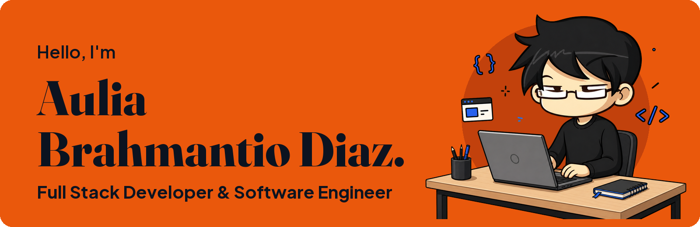

<p align="center">
  <a href="https://brahmantiodiaz.com">
    <picture>
      <source media="(max-width: 600px)" srcset="assets/header-mobile.png"/>
      
    </picture>
  </a>
</p>

<p align="center">
  Jakarta, Indonesia · <a href="https://brahmantiodiaz.com"><b>brahmantiodiaz.com</b></a>
</p>

<p align="center">
  
</p>

<p align="center">
  <a href="https://brahmantiodiaz.com"></a>
  <a href="mailto:auliabrahmantio@gmail.com"></a>
  <a href="https://www.linkedin.com/in/auliabrahmantiodiaz/"></a>
  <a href="https://www.hackerrank.com/brahmantiodiaz"></a>
  
</p>

<p align="center">
  <a href="#about">About</a> ·
  <a href="#stack">Stack</a> ·
  <a href="#activity">Activity</a> ·
  <a href="#contact">Contact</a>
</p>


## About

<table>
<tr>
<td width="52%" valign="top">

I'm Diaz, a full stack developer and software engineer. I like building web apps from the database up to the screen, and turning ideas into products that people find useful.

Right now that means Go on the backend, Next.js on the frontend, and Kubernetes for getting both into production.

Learning new things is one of my favorite habits. Most of the stack on this page started as something I didn't know yet.

I'm open to collaboration and project opportunities.

</td>
<td width="48%" valign="top">

```go
type Developer struct {
	Name    string
	Role    string
	Stack   map[string][]string
}

var aulia = Developer{
	Name:    "Aulia Brahmantio Diaz",
	Role:    "Fullstack Developer",
	Stack: map[string][]string{
		"backend":  {"Go", "Fiber", "Kafka", "PostgreSQL"},
		"frontend": {"Next.js", "React", "TypeScript"},
		"platform": {"Kubernetes", "Argo CD", "OpenTofu"},
	},
}
```

</td>
</tr>
</table>


## Stack

Everything I've worked with.

<table>
<tr>
<td width="50%" align="center">
<b>Languages</b><br/><br/>

</td>
<td width="50%" align="center">
<b>Frontend</b><br/><br/>

</td>
</tr>
<tr>
<td align="center">
<b>Backend</b><br/><br/>

</td>
<td align="center">
<b>Databases and messaging</b><br/><br/>

</td>
</tr>
<tr>
<td align="center">
<b>Cloud and DevOps</b><br/><br/>

</td>
<td align="center">
<b>Tools and testing</b><br/><br/>

</td>
</tr>
</table>


## Activity

<p align="center">
  
</p>


## Contact

Email me or send a message on LinkedIn. I'm happy to talk about backend systems, dashboards, or a project you're working on. My projects and experience are on <a href="https://brahmantiodiaz.com">brahmantiodiaz.com</a>.

<p>
  <a href="https://brahmantiodiaz.com"></a>
  <a href="mailto:auliabrahmantio@gmail.com"></a>
  <a href="https://www.linkedin.com/in/auliabrahmantiodiaz/"></a>
  <a href="https://www.hackerrank.com/brahmantiodiaz"></a>
</p>

<p align="center">
  
</p>
